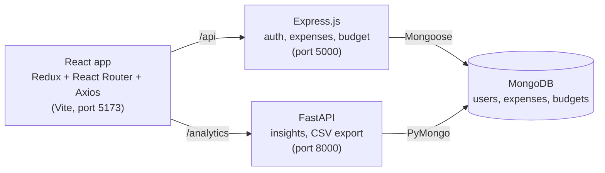

# SpendWise: Student Expense Tracker

Track where your pocket money goes, every month.

SpendWise is a full-stack **Single Page Application** for students. Record daily expenses, set a monthly budget, see spending by category, and get smart insights about your month. Built for the **JavaScript Framework (PBL) - C2620A3** course.

**Stack:** React (Vite) + Redux Toolkit + React Router + Axios | Node.js + Express.js | Python FastAPI | MongoDB | JWT


## Live demo

| Part | Link |
| --- | --- |
| Web app (React + Express) | https://student-expense-tracker-znf1.onrender.com |
| Analytics API (FastAPI) | https://student-expense-tracker-api-lqll.onrender.com/health |

> Both services run on Render's free plan, so they go to sleep when nobody uses them. The first request can take 30 to 50 seconds. Open both links once and wait before a demo.
> The live database starts empty: click **Create an account** to register. (The demo account `demo@student.com` / `demo123` exists only after running `npm run seed` locally.)

## Features

- **Secure accounts:** register, log in and log out. Passwords are hashed with bcrypt and sessions use JWT tokens.
- **Private data:** every student sees only their own expenses and budget.
- **Expenses:** add, edit and delete with title, amount, category (9 categories), payment method (Cash, UPI, Card), date and note.
- **Monthly view:** month picker, search by title and filter by category.
- **Monthly budget:** progress bar that turns orange at 80% and red at 100%, with a warning message.
- **Live summary:** total spent, money left, daily average and number of expenses.
- **Category chart:** donut chart of spending per category (MongoDB aggregation).
- **Insights page (FastAPI):** projected month-end spending, daily spending chart, top category, biggest expense, payment-mode split and tips based on your budget pace.
- **CSV export:** download a month's expenses as a CSV file (opens in Excel).
- **Single Page App:** React Router pages `/login`, `/dashboard` and `/insights`. Protected pages redirect to `/login`.
- **State management:** Redux Toolkit store for login state and dashboard data.
- **Responsive:** works on phones and laptops.
- **Validation:** form checks in React and schema checks in Mongoose and FastAPI.

## Tech stack

| Layer | Technology |
| --- | --- |
| Frontend | React (Vite), Redux Toolkit, React Router, Axios, Recharts |
| Main backend | Node.js, Express.js (auth, expenses, budget) |
| Analytics service | Python FastAPI, Pydantic, Uvicorn |
| Database | MongoDB (Mongoose in Express, PyMongo in FastAPI) |
| Security | JWT (shared by both backends), bcrypt |

## Architecture



The browser never talks to the database directly. React calls the two backends with Axios, and both backends read the same MongoDB database.

### How JWT login works here

1. The student logs in. Express checks the password with bcrypt and creates a JWT (`{ id }`, signed with `JWT_SECRET`, valid for 7 days).
2. React (Redux `authSlice`) saves the token in `localStorage`.
3. An Axios interceptor adds `Authorization: Bearer <token>` to every request, to Express and to FastAPI.
4. Express (`requireAuth` middleware) and FastAPI (`current_user_id` dependency) verify the token with the **same `JWT_SECRET`** and read the user id from it.
5. Every database query is limited to that user's id. A missing, wrong or expired token returns `401` and the app sends the user back to `/login`.

### Database

| Collection | Main fields |
| --- | --- |
| `users` | name, email (unique), password (bcrypt hash) |
| `expenses` | user, title (max 60), amount (at least 1), category, paymentMethod, date, note (max 200) |
| `budgets` | user, month (`YYYY-MM`), amount. Unique per user and month. |

## Folder structure

```
student-expense-tracker/
├── backend/                  # Node.js + Express API
│   ├── middleware/auth.js    # createToken + requireAuth (JWT)
│   ├── models/               # User.js, Expense.js, Budget.js
│   ├── routes/               # auth.js, expenses.js, budget.js
│   ├── server.js             # Express server + MongoDB connection
│   ├── seed.js               # Demo user and sample expenses
│   └── .env.example
├── fastapi-service/          # Python FastAPI analytics service
│   ├── main.py               # Routes: /health, /analytics/insights, /analytics/export
│   ├── auth.py               # Verifies the JWT created by Express
│   ├── analytics.py          # MongoDB aggregations and tips
│   ├── schemas.py            # Pydantic response models
│   ├── config.py, db.py
│   ├── requirements.txt
│   └── .env.example
└── frontend/                 # React (Vite) app
    ├── src/
    │   ├── components/       # AuthPage, ProtectedRoute, Navbar, Dashboard, Insights,
    │   │                     # ExpenseForm, ExpenseList, SummaryCards, CategoryChart
    │   ├── store/            # index.js, authSlice.js, expensesSlice.js (Redux Toolkit)
    │   ├── api.js            # Axios clients for Express and FastAPI
    │   ├── utils.js
    │   ├── App.jsx           # React Router routes
    │   └── main.jsx
    └── vite.config.js        # Dev proxy: /api -> 5000, /analytics -> 8000
```

## Run locally

### What you need

- [Node.js](https://nodejs.org) (LTS)
- [Python 3.10 or newer](https://www.python.org/downloads)
- MongoDB: [MongoDB Community Server](https://www.mongodb.com/try/download/community) on your laptop, or a free [MongoDB Atlas](https://www.mongodb.com/atlas) cluster

Open **three terminals** in the project folder.

**Terminal 1: Express backend**

```bash
cd backend
npm install
copy .env.example .env      # Mac/Linux: cp .env.example .env
npm run seed                # optional: demo@student.com / demo123 with sample expenses
npm run dev
```

You should see `Connected to MongoDB` and `Server running on http://localhost:5000`.

**Terminal 2: FastAPI service**

```bash
cd fastapi-service
python -m venv venv
venv\Scripts\activate       # Mac/Linux: source venv/bin/activate
pip install -r requirements.txt
copy .env.example .env      # Mac/Linux: cp .env.example .env
python -m uvicorn main:app --reload --port 8000
```

Open `fastapi-service/.env` and set `JWT_SECRET` to **exactly the same value** as in `backend/.env`. Check http://localhost:8000/health. API docs (Swagger) are at http://localhost:8000/docs.

**Terminal 3: React frontend**

```bash
cd frontend
npm install
npm run dev
```

Open http://localhost:5173. Restart this terminal if you change `vite.config.js`.

### Environment variables

| File | Variable | Meaning |
| --- | --- | --- |
| `backend/.env` | `PORT` | Server port (default 5000) |
| | `MONGO_URI` | MongoDB connection string |
| | `JWT_SECRET` | Secret used to sign login tokens |
| `fastapi-service/.env` | `MONGO_URI` | Same database as Express |
| | `JWT_SECRET` | **Must match** the value in `backend/.env` |
| | `CORS_ORIGINS` | Frontend addresses allowed to call FastAPI (default `http://localhost:5173`) |
| frontend (build time) | `VITE_ANALYTICS_URL` | FastAPI address, needed only for a production build |

`.env` files are listed in `.gitignore` and are never pushed to GitHub.

## API endpoints

### Express (port 5000)

All `/api/expenses` and `/api/budget` routes need the header `Authorization: Bearer <token>`.

| Method | Endpoint | What it does |
| --- | --- | --- |
| POST | `/api/auth/register` | Create an account `{ name, email, password }` and get `{ token, user }` |
| POST | `/api/auth/login` | Log in `{ email, password }` and get `{ token, user }` |
| GET | `/api/auth/me` | The logged-in user |
| GET | `/api/expenses?month=2026-10&category=Food&search=pizza` | List expenses (filters are optional) |
| POST | `/api/expenses` | Add an expense |
| PUT | `/api/expenses/:id` | Update an expense |
| DELETE | `/api/expenses/:id` | Delete an expense |
| GET | `/api/expenses/summary?month=2026-10` | Total, count and total per category |
| GET | `/api/expenses/categories` | Allowed categories and payment methods |
| GET | `/api/budget/:month` | Get the budget for a month |
| PUT | `/api/budget/:month` | Set the budget for a month |
| GET | `/api/health` | Server and database status |

Example body for `POST /api/expenses`:

```json
{
  "title": "Canteen lunch",
  "amount": 80,
  "category": "Food",
  "paymentMethod": "UPI",
  "date": "2026-10-20",
  "note": "with friends"
}
```

### FastAPI (port 8000)

The analytics routes need the same `Authorization: Bearer <token>` header.

| Method | Endpoint | What it does |
| --- | --- | --- |
| GET | `/health` | Service and database status |
| GET | `/analytics/insights?month=2026-10` | Total, daily average, projected month-end spending, top category, biggest expense, payment-mode split, daily totals, budget status and tips |
| GET | `/analytics/export?month=2026-10` | Download the month's expenses as a CSV file |

## Deploy on Render (free)

The app runs as **two Render web services** plus a free MongoDB Atlas database.

1. **MongoDB Atlas:** create a free cluster and a database user (use a password with only letters and numbers). Under Network Access allow `0.0.0.0/0`. Copy the connection string and add `/student_expense_tracker` before the `?`.
2. **FastAPI service** (New, Web Service, this repo):
   - Root Directory: `fastapi-service`
   - Build Command: `pip install -r requirements.txt`
   - Start Command: `uvicorn main:app --host 0.0.0.0 --port $PORT`
   - Environment: `MONGO_URI`, `JWT_SECRET`, `PYTHON_VERSION=3.12.8`, `CORS_ORIGINS=<address of the web app>`
3. **Express + React service** (New, Web Service, this repo):
   - Root Directory: leave empty
   - Build Command: `cd frontend && npm install --include=dev && npm run build && cd ../backend && npm install`
   - Start Command: `cd backend && npm start`
   - Environment: `MONGO_URI`, `JWT_SECRET` (**the same value as the FastAPI service**), `VITE_ANALYTICS_URL=<address of the FastAPI service>`
4. After changing `VITE_ANALYTICS_URL`, use **Clear build cache & deploy**, because the value is baked into the React build.

Express serves the built React app from `frontend/dist`, so the web app needs only one address.

## Common problems

| Problem | Fix |
| --- | --- |
| `Could not connect to MongoDB` | Start MongoDB, or check `MONGO_URI`. On Atlas: allow your IP in Network Access and check the user and password (`bad auth` means a wrong username or password). |
| `Could not reach the server` in the app | The Express terminal is not running. Start it with `npm run dev`. |
| Insights page shows an error or loads forever | Start the FastAPI terminal. Check that `/analytics` is proxied (restart `npm run dev`) or that `VITE_ANALYTICS_URL` is set for a deployed build. |
| Opening Insights sends you back to the login page | `JWT_SECRET` is different in Express and FastAPI. Make both the same, restart both and log in again. |
| `Cannot GET /` on Render | The React app was not built. Use the Build Command from the deploy section. |
| First page load is very slow on Render | The free plan was sleeping. Wait up to 50 seconds. |
| Port already in use | Close the other terminal running the app, or change `PORT` in `.env`. |

## Author

**Tisha Rakholiya**
JavaScript Framework (PBL) - C2620A3

<!-- Tip: add screenshots here, for example:


-->
